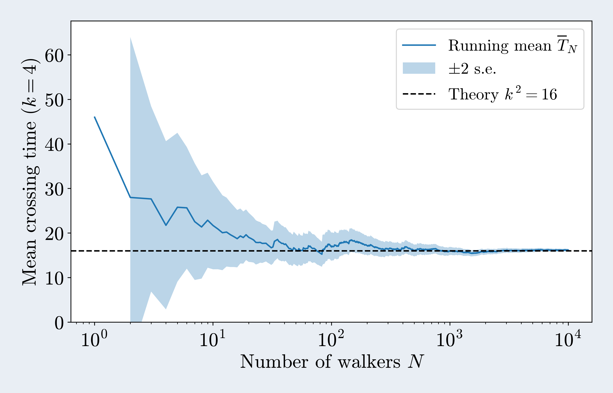
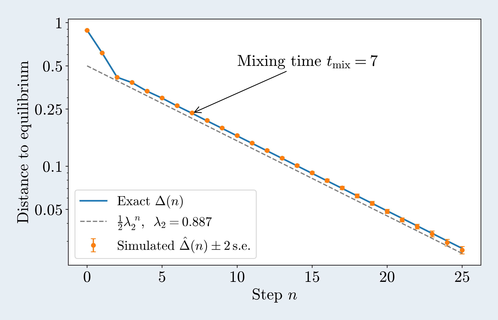

# Random walks on barbell graphs: mixing and "echo chambers"

Individual simulation project for *Introduction to Stochastic Methods* (USI, Autumn 2026).

**Model.** Two communities, each a complete graph $K_k$, joined by a single bridge edge.
A message starts at an interior node $v_0$ and is passed at each step to a uniformly
random neighbor (simple random walk). [Picture](poster/images/barbell.pdf)


**Questions.**
1. How long until the message reaches the other community (hitting time of the bridge)?
2. How fast does the walk settle to its stationary distribution (mixing time)?

**Results.**

- **Crossing time.** First-step analysis gives exactly $\mathbb{E}[T_{\text{cross}}] = k^2$. Simulations with $N = 10^4$ walkers for $k \in \{3, 4, 7, 8, 15\}$ match it within $\pm 2$ standard errors (e.g. $k = 15$: $226.6 \pm 2.3$ vs. $225$).

  

- **Mixing.** For $k = 4$ the total variation distance to equilibrium decays as $\Delta(n) \approx \tfrac12 |\lambda_2|^n$ with $\lambda_2 = 0.887$, giving $t_{\text{mix}} = 7$ (threshold $1/4$). The simulated distance ($R = 30$ runs of $N = 10^4$ walkers) follows the exact curve.

  

Full poster: [poster/poster.pdf](poster/poster.pdf)


Full poster: [poster/poster.pdf](poster/poster.pdf)

## Reproduce

All parameters are set at the top of `code/main.py`.

```bash
pip install -r code/requirements.txt
python code/main.py
```

This regenerates all data and figures used in the poster.
